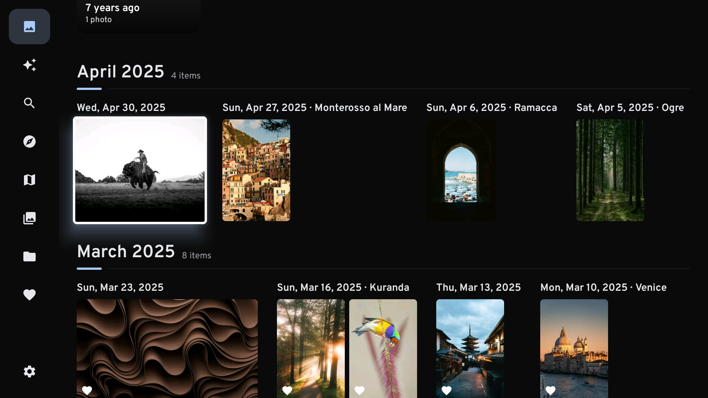
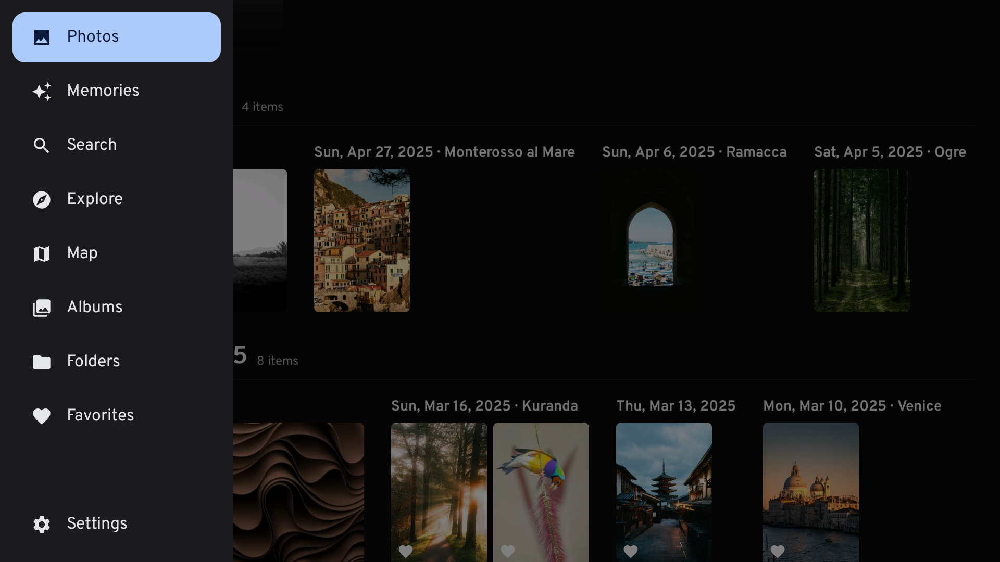
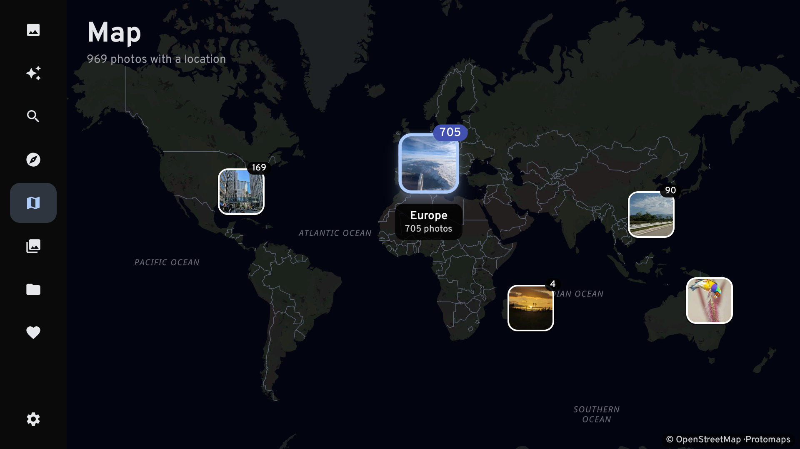
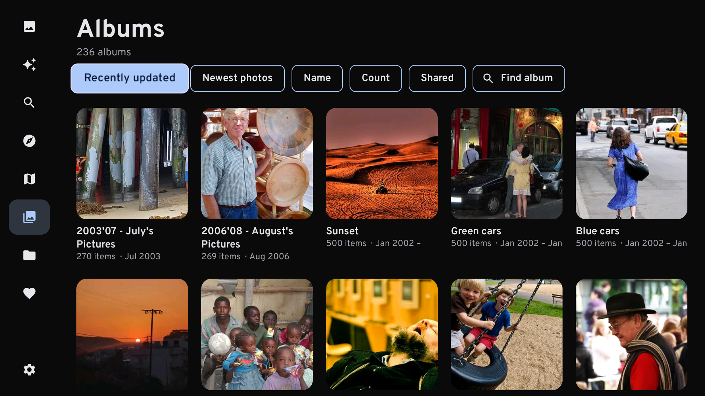
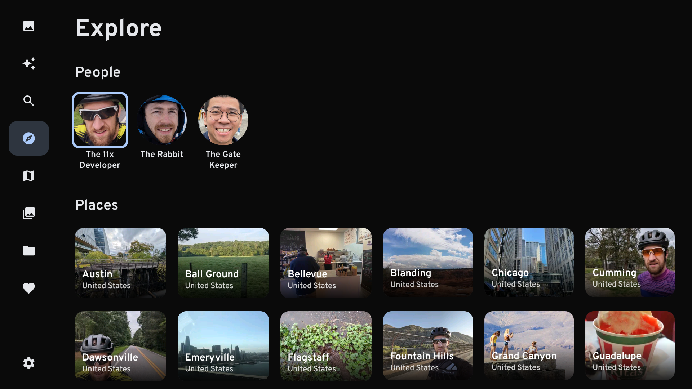

# TV Client for Immich (unofficial)

Enjoy your [Immich](https://immich.app) photo and video library on the big screen. Designed specifically for Android TV devices.

## What you can do

- 🖼️ **Browse your timeline** 
- 🕰️ **Relive Memories** 
- 🎞️ **Play slideshows** 
- 🔍 **Search easily** 
- 📁 **Explore by people, places, albums, & folders** 
- 🗺️ **World map** 
- 📺 **TV Screensaver** 
- 🌐 **Multi-language** 

## Screenshots

Released under the [MIT License](LICENSE). Uses map data from [OpenStreetMap](https://www.openstreetmap.org/copyright) / [Protomaps](https://protomaps.com), [Natural Earth](https://www.naturalearthdata.com), and [Sentinel-2 cloudless](https://s2maps.eu) by EOX (CC BY-NC-SA 4.0, non-commercial use only).
